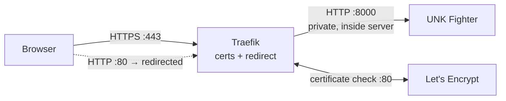

# Deploying UNK Fighter with Docker

## Pick your situation

| I want to… | Use | Address |
|---|---|---|
| Try it on my own computer | **Local** (below) | `http://localhost:8000` |
| Put it on a server for others | **Server with HTTPS** (below) | `https://<your hostname>` |
| Put it on the server that already runs docent | **Alongside docent** (below) | `https://<docent hostname>:8000` |

## What's in the image, and what isn't

The image carries the code and the built game: sprite sheets, arenas, character music,
sound effects, the splash video and the selection music. `docker build` makes the sprite
sheets itself from the frames in `Characters/*/frames` (no API calls), so the host needs
nothing but Docker: no Python, no keys. Your local `build/` folder is ignored.

Two things are **mounted** instead, so they survive rebuilds and never end up in the image:

- `users.csv`: the logins, `username,password,character` per line. The last item is the fighter
  that user always plays (e.g. `Tonian` or `The Koop`); players only choose their opponent.
  The first account in the file may pick any fighter.
- `data/`: the high-score database (`data/scores.db`). Back this folder up.

The server needs **no API keys**. Gemini and ElevenLabs are only used by
`add_character.py` and `make_sounds.py`, which you run on your own machine. After adding
a character or regenerating sounds, rebuild the image (`--build` below) to ship them.

## Prerequisite

Install Docker Desktop and start it:

```bash
brew install --cask docker
open -a Docker            # then wait for it to finish starting
docker info               # should succeed once the daemon is up
```

`users.csv` must exist **before** the first start. If it's missing, Docker creates an
empty directory with that name and every login fails; delete the directory and add the file.

## Local

```bash
docker compose up --build        # or: ./docker-run.sh
```

Open `http://localhost:8000` and log in with a `users.csv` account. Plain HTTP is fine
on your own machine. Use `UNK_PORT=9000 docker compose up --build` for another port.

## Server with HTTPS

Logins use basic auth, which sends the password with every request, so a server
**must** use HTTPS. As in docent, **Traefik** sits in front, gets a free, trusted
certificate from Let's Encrypt, renews it itself, and passes visitors through to the
game over plain HTTP inside the server.



### Before you start

- A server with Docker + Compose, reachable from the internet on ports **80 and 443**.
- A DNS **A/AAAA record** for the hostname pointing at that server.
- This folder copied to the server (a `git clone` works), **including `Characters/*/frames`**:
  the image builds the sprite sheets from them. Plus `users.csv`, which isn't in git or the
  image. For example: `rsync -av --exclude .venv --exclude build --exclude Sounds/raw ./ <server>:unk/`
- No Python needed on the server. `source setup.sh` only sets `UNK_HOSTNAME` and `ACME_EMAIL`.

### Deploy

```bash
export UNK_HOSTNAME=unk.ncsa.illinois.edu   # your real hostname
export ACME_EMAIL=you@illinois.edu          # certificate expiry notices
./start.sh                                  # ./stop.sh to take it down
```

`start.sh` runs `docker compose -f docker-compose.yml -f docker-compose.https.yml up -d --build`.
Both variables are required; compose refuses to start without them. Then open
`https://$UNK_HOSTNAME`. The first load may take a few seconds while the certificate is
issued. Certificates persist in the `letsencrypt` volume, so redeploys don't re-request them.

To ship new characters or sounds: copy the updated folder over and run `./start.sh` again.

### Notes

- Debugging certificates? Temporarily add
  `--certificatesresolvers.le.acme.caserver=https://acme-staging-v02.api.letsencrypt.org/directory`
  to Traefik's `command` to avoid Let's Encrypt rate limits (staging certs are untrusted).
- If a campus firewall blocks port 80, the HTTP challenge fails; use a DNS challenge or
  institution-provided certificates instead.

## Alongside docent

docent's `docker-compose.multi.yml` already runs a Traefik that owns ports 80 and 443,
so a second Traefik can't start on that server. Instead, add the game to docent's file
as another service on its own port; docent's one certificate covers every port.

In docent's `docker-compose.multi.yml`, add an entrypoint and port to the `traefik` service. (Port 8000 here is Traefik's public
HTTPS port; the game's own port 8000 stays private inside Docker's network, so they don't clash.)

```yaml
      - --entrypoints.unk.address=:8000       # in traefik's command
      - "8000:8000"                           # in traefik's ports
```

and this service (adjust `context` to where this folder lives on the server):

```yaml
  unk:                          # UNK Fighter  ->  https://${DOCENT_HOSTNAME}:8000
    build: ../UNK
    image: unk-fighter:latest
    expose: ["8000"]
    volumes:
      - ../UNK/users.csv:/app/users.csv:ro
      - ../UNK/data:/app/data
    labels:
      - traefik.enable=true
      - traefik.http.routers.unk.rule=Host(`${DOCENT_HOSTNAME:?set DOCENT_HOSTNAME}`)
      - traefik.http.routers.unk.entrypoints=unk          # port 8000
      - traefik.http.routers.unk.tls.certresolver=le
      - traefik.http.services.unk.loadbalancer.server.port=8000
    restart: unless-stopped
```

Open port 8000 on the server, then redeploy docent as usual. Don't also run this folder's
`start.sh` or `docker compose up` on that server: docent's file now runs the game. The game is at
`https://$DOCENT_HOSTNAME:8000`.

## Knobs

| Env | Default | Purpose |
|---|---|---|
| `UNK_PORT` (compose / docker-run.sh) | `8000` | Port published on your machine (local mode) |
| `UNK_HOSTNAME` | (required) | Hostname for the HTTPS deployment |
| `ACME_EMAIL` | (required) | Let's Encrypt contact for the HTTPS deployment |
| `UNK_HOST` / `UNK_PORT` (inside the container) | `0.0.0.0` / `8000` | What `server.py` binds |
