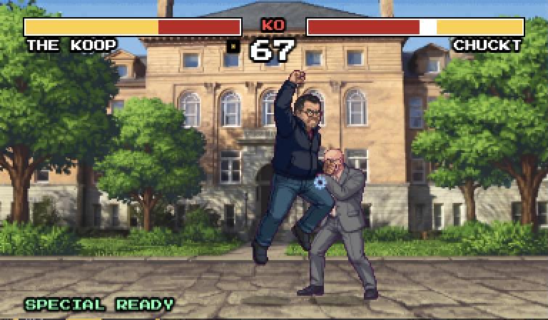
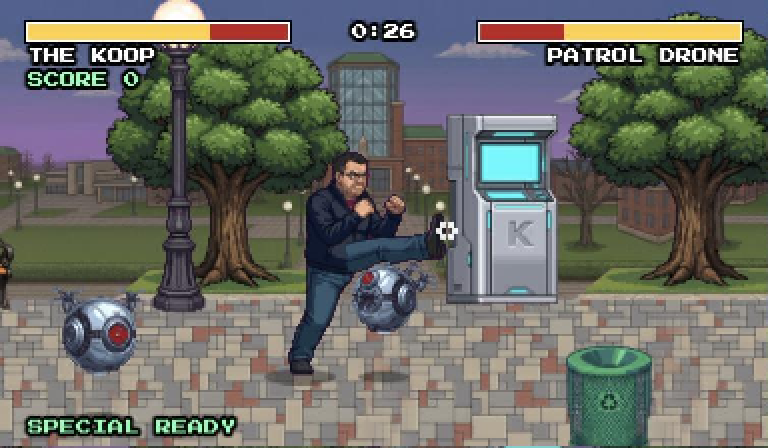

# UNK Fighter

A 16-bit, SNES-style fighting game that runs in the browser, starring the people of UNK. Every fighter,
arena, campaign level and sound is generated from a photo and a short text description, so adding
someone new to the roster is one command.

| One-on-one match | Campaign |
|---|---|
|  |  |

- **One-on-one matches** in each fighter's home arena, to their own theme music, best of three rounds
- **Campaigns**: a side-scrolling, beat-'em-up street of enemy waves and a mini boss, ending in a boss
  fight in the boss's arena
- **Special moves** made from each fighter's description, with their own inputs, props and shouts
- **Combos, combo breakers and the rising uppercut**, plus three CPU difficulty levels
- **Arcade high scores** with initials, logins per player, and a guest account
- **Keyboard, mouse or Xbox-style controller**; an 800×600 window or full screen, always with sharp pixels

The game draws at 384×224 (SNES height, widescreen width) and scales up by whole multiples.

## Quick start

You need Python 3.11+.

```bash
python3 -m venv .venv
.venv/bin/pip install -r requirements.txt
```

Once your key files are in place (see [Adding a fighter](#adding-a-fighter)), `source setup.sh` does this for
you instead: it creates `.venv` the first time, activates it, and loads the keys.

Create `users.csv` (it's kept out of git) with one login per line,
`username,password,character`. The character is the fighter that player always plays; players
choose only their opponent. A `guest` login may pick any fighter:

```csv
alice,changeme,Tonian
guest,guestpassword
```

Then start the server and open <http://localhost:8000>:

```bash
.venv/bin/python server.py
```

`--port`, `--host 0.0.0.0` (to play over the LAN) and `--reload` (development) are available;
`python server.py --help` lists them all.

To run it with Docker instead, or to put it on a server with HTTPS, see **[DEPLOY.md](DEPLOY.md)**.

## Controls

| | Keyboard / mouse | Controller |
|---|---|---|
| Move | ← → (or A D) | Stick / D-pad |
| Jump · crouch | ↑ · ↓ | A · down |
| Punch | J or left click | X |
| Kick | K or right click | Y / B |
| Block | hold back (back + ↓ blocks low) | hold back · RB on the street |
| Pause | Esc | Start |
| Full screen | F | |
| Music · sound effects | M · N (on the menu or paused) | |

- **Uppercut**: ↑ + punch together
- **Dive kick**: ↓ + punch or kick in the air
- **Combo breaker**: while being comboed, ↓ ↓ ↑, then ↑ + punch
- **Rising uppercut**: knocked down or launched? Punch just as you land or get up
- **Specials**: each fighter's inputs are listed on the select screen (→ means toward the opponent)
- **Combos**: hits landed back to back score more the longer the chain

## Adding a fighter

Fighters are generated with Google's Gemini image models, so these tools need a Gemini API key, in
`gemini_key.txt` or the `GEMINI_API_KEY` environment variable. The game server itself needs no keys.

1. Make a folder `Characters/<Name>/` with a reference photo, `<Name>.jpg` (or `.png`).
2. Run the tool. The first run writes a template `<Name>.txt`; describe the fighter's personality and
   special moves in your own words, then run it again:

   ```bash
   .venv/bin/python add_character.py Characters/<Name>
   ```

3. Optional extras in the same folder: `Arena_<Place>.jpg` is their home arena and `<Name>.mp3` its music.

The tool works in stages:

- **parse**: the text becomes `character.json`, with stats, specials and expressions. You can edit it.
- **frames**: every animation frame is drawn and checked for anatomy mistakes. The frames are cached,
  so only changed moves are redrawn.
- **sheet**: the frames are packed into `build/characters/`, which is what the game serves.

A new fighter costs a few dollars in API calls. Useful options:

- `--placeholder`: a playable fighter with no API calls
- `--only punch,kick --force`: redraw just those frames
- `--all --stage sheet`: rebuild every sheet for free

## Adding a campaign

```bash
.venv/bin/python add_campaign.py Characters/<Name>
```

The first run writes `Characters/<Name>/campaign.txt`. Describe the story, the setting and the enemies
(an optional `Mini boss: <Fighter>` line picks one), then run it again. The tool then:

- extends the boss's arena into a scrolling street;
- draws the floor, props and enemy sprites;
- lays out the enemy waves in `build/campaigns/`.

A `campaign.mp3` in the folder plays on the street. Preview a level at
`/static/campaign.html?c=<slug>`. `--stage build` re-lays out a level without any API calls.

## Sounds

Sound effects and the announcer come from ElevenLabs (`elevenlabs_key.txt`) via `make_sounds.py`, and
are processed to sound like SNES samples. Your own recordings can replace any of them:

```bash
.venv/bin/python make_sounds.py --import ~/Downloads/Punch.mp3 hit_heavy
```

## Project layout

| Path | What it is |
|---|---|
| `server.py` | FastAPI server: logins, rosters, arenas, campaigns, high scores |
| `static/` | The game: `game.js` (matches), `brawl.js` (campaigns), `sound.js`, `gamepad.js`, `index.html` |
| `add_character.py` | Builds a fighter from a photo and a description |
| `add_campaign.py` | Builds a campaign level for a fighter |
| `make_sounds.py` | Generates the sound effects and announcer |
| `Characters/<Name>/` | Each fighter's sources: photo, description, arena, music, cached frames, campaign |
| `build/` | Built sprite sheets, arenas and campaign levels (committed; this is what is served) |
| `Sounds/` | Sound effects and announcer lines |
| `data/` | High scores and changed passwords, `scores.db` (not committed) |
| `DEPLOY.md` | Docker, HTTPS and server setup |

**Keep these out of git:** `users.csv`, `data/` and the API key files (`gemini_key.txt`,
`elevenlabs_key.txt`, `github_key.txt`) hold passwords and secrets. They're already listed in `.gitignore`.
